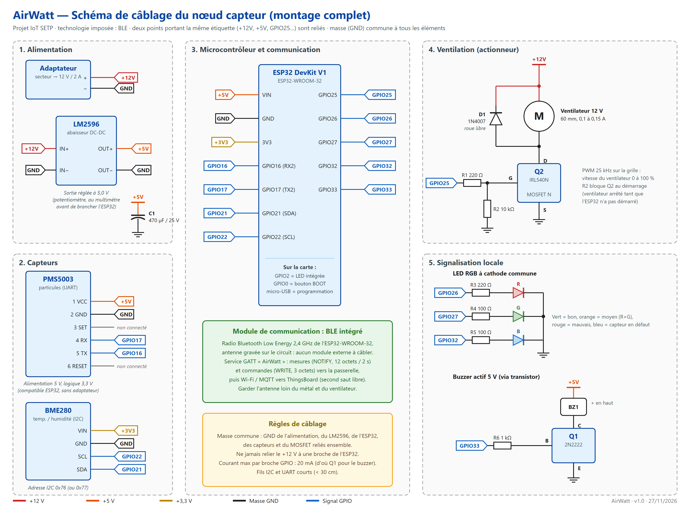

# Schéma de câblage — nœud capteur AirWatt (montage complet)

Livrable « Wiring / connection diagram » du cahier des charges : brochage du microcontrôleur,
connexions des capteurs et actionneurs, alimentation, câblage du module de communication.

Fichiers : `schema-cablage.svg` (vectoriel), `schema-cablage.png` (3200 × 2360 px, pour le
rapport), `generer_schema.py` (régénère le SVG après une modification).

Le prototype de démonstration utilise une **ESP32 seule** (configuration `carte_seule` du
firmware) : le BLE, le bouton BOOT et la LED intégrée sont réels, les capteurs sont simulés.
Ce schéma décrit le **montage complet** visé, celui que chiffre l'estimation de prix.

## 1. Brochage de l'ESP32 DevKit V1

| Broche ESP32 | Relié à | Type | Remarque |
| --- | --- | --- | --- |
| VIN | +5V (sortie LM2596) | Alimentation | Entrée du régulateur 3,3 V de la carte |
| GND | Masse commune | Alimentation | |
| 3V3 | VIN du BME280 | Alimentation | Sortie du régulateur de la carte |
| GPIO16 (RX2) | TX du PMS5003 (broche 5) | UART 9600 bauds | Trames de 32 octets |
| GPIO17 (TX2) | RX du PMS5003 (broche 4) | UART | Facultatif (commandes du capteur) |
| GPIO21 (SDA) | SDA du BME280 | I2C | Adresse 0x76 ou 0x77 |
| GPIO22 (SCL) | SCL du BME280 | I2C | |
| GPIO25 | Grille de Q2 via R1 220 Ω | PWM 25 kHz | Vitesse du ventilateur |
| GPIO26 | LED RGB rouge via R3 220 Ω | Sortie | |
| GPIO27 | LED RGB verte via R4 100 Ω | Sortie | |
| GPIO32 | LED RGB bleue via R5 100 Ω | Sortie | |
| GPIO33 | Base de Q1 via R6 1 kΩ | Sortie | Commande du buzzer |
| GPIO2 | LED intégrée (sur la carte) | PWM | Utilisée en mode « carte seule » |
| GPIO0 | Bouton BOOT (sur la carte) | Entrée | Pic de pollution simulé |

**Module de communication :** la radio BLE est intégrée à l'ESP32-WROOM-32 (antenne gravée).
Aucun module externe n'est câblé ; il faut seulement éloigner l'antenne du métal et du ventilateur.

## 2. Alimentation

- **Adaptateur secteur 12 V / 2 A** : alimente le ventilateur (+12V) et le LM2596.
- **LM2596** : abaisse le 12 V en **5,0 V** (à régler au multimètre **avant** de brancher l'ESP32)
  pour l'ESP32 (VIN) et le PMS5003.
- **Régulateur 3,3 V de la carte ESP32** : alimente le BME280 et les LED.
- **C1 470 µF** sur le +5V : absorbe les appels de courant du ventilateur interne du PMS5003 et
  des émissions radio.
- **Masse commune** à tous les éléments ; le +12 V ne touche jamais une broche de l'ESP32.

## 3. Choix des composants

| Repère | Composant | Justification |
| --- | --- | --- |
| Q2 | MOSFET IRL540N (niveau logique ; l'IRLZ44N convient aussi mais est introuvable en Tunisie) | Seuil de grille de 1 à 2 V : commute correctement avec les 3,3 V de l'ESP32 (contrairement à l'IRF520, très répandu en module mais prévu pour 10 V) |
| R1 | 220 Ω | Limite le courant de charge de la grille vu par la broche GPIO25 |
| R2 | 10 kΩ | Maintient Q2 bloqué au démarrage : ventilateur arrêté tant que l'ESP32 ne pilote pas |
| D1 | 1N4007 | Diode de roue libre : absorbe la surtension du moteur à chaque coupure du PWM |
| Q1, R6 | 2N2222 + 1 kΩ | Le buzzer consomme environ 30 mA, au-delà des 20 mA conseillés par broche GPIO ; courant de base ≈ (3,3 − 0,7) / 1000 ≈ 2,6 mA |
| R3 | 220 Ω (rouge) | (3,3 − 2,0) / 220 ≈ 6 mA |
| R4, R5 | 100 Ω (vert, bleu) | Tension de seuil ≈ 3 V : avec 220 Ω, à peine 1 mA ; 100 Ω donne ≈ 3 mA |

## 4. Bilan de consommation (valeurs maximales)

| Élément | Rail | Courant max | Source |
| --- | --- | --- | --- |
| ESP32 (BLE actif) | +5V | ≈ 130 mA | Ordre de grandeur de la fiche technique ESP32 en émission radio |
| PMS5003 | +5V | ≤ 100 mA | Fiche technique Plantower (courant actif) |
| Buzzer (pendant une alerte) | +5V | ≈ 30 mA | Buzzer actif 5 V typique |
| BME280 + LED RGB | +3V3 (via l'ESP32) | ≈ 15 mA | Inclus dans le courant de la carte |
| **Total rail +5V** | | **≈ 260 mA → 1,3 W** | |
| Ventilateur 60 mm | +12V | 100 à 150 mA → 1,8 W max | Étiquette du ventilateur |
| LM2596 (rendement ≈ 85 %) | +12V | 1,3 W / 0,85 / 12 V ≈ 130 mA | |
| **Total sur l'adaptateur 12 V** | | **≈ 280 mA → environ 3,4 W** | Marge × 7 avec un adaptateur 2 A |

**Argument pour le pitch :** le nœud consomme moins de **4 W**, ventilateur compris. Sur un vrai
extracteur d'atelier de plusieurs centaines de watts, ralentir à mi-vitesse divise la puissance
par 8 : l'électronique de pilotage est négligeable devant l'énergie économisée.

## 5. Contrôles avant la première mise sous tension

- [ ] LM2596 réglé à 5,0 V à vide (multimètre), **avant** de brancher l'ESP32
- [ ] Aucun fil entre le +12 V et une broche de l'ESP32
- [ ] Orientation de D1 (bague côté +12 V) et de C1 (− à la masse)
- [ ] Brochage du connecteur PMS5003 vérifié sur la fiche du câble fourni (l'ordre varie)
- [ ] Puce BME280 confirmée au démarrage (identifiant 0x60 affiché sans erreur dans le moniteur série)
